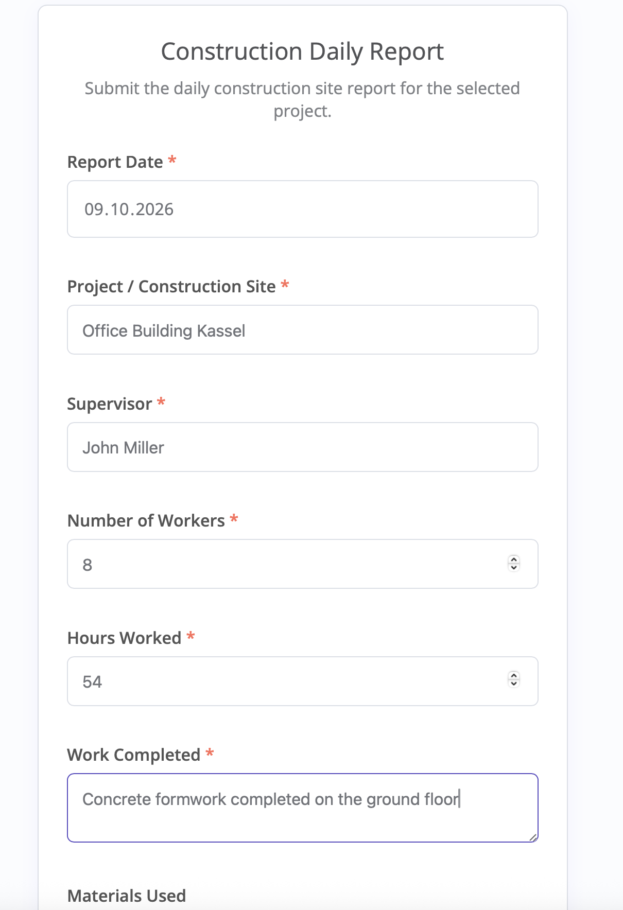
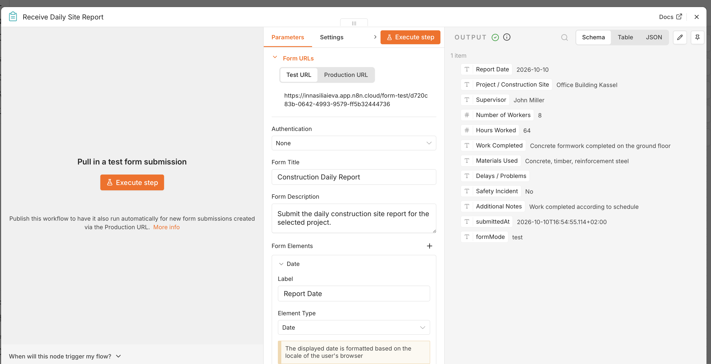
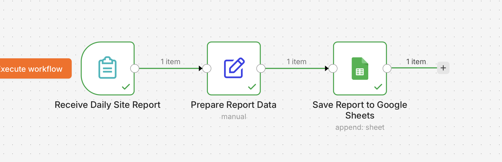
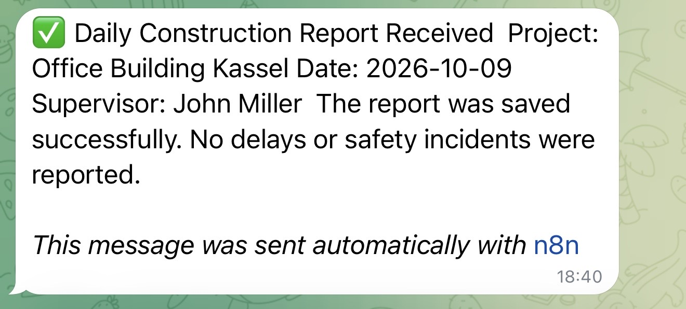
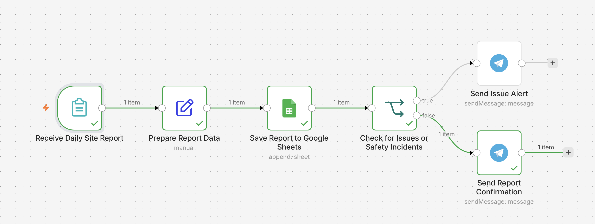
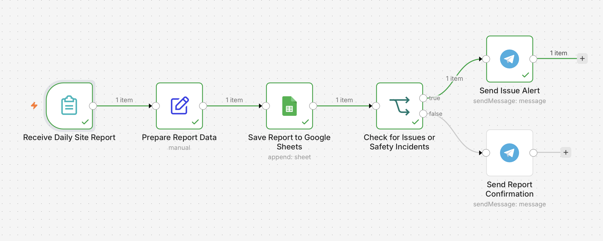
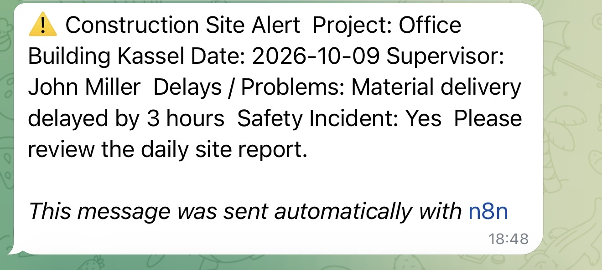
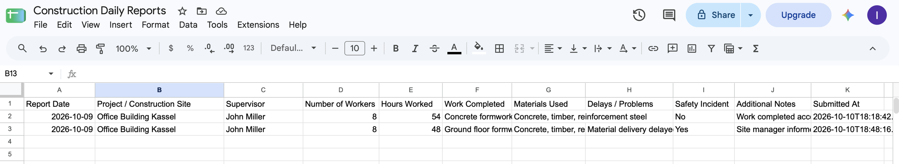

# Construction Daily Report Automation

An n8n workflow for automating daily construction site reporting.

The workflow collects structured site reports through an n8n form, prepares the submitted data, stores every report in Google Sheets, checks for delays or safety incidents, and sends the appropriate Telegram notification.

## Workflow

`Daily Report Form → Prepare Data → Google Sheets → Issue Check → Telegram Notification`

### Automation Logic

- Collects daily construction site reports through an n8n form
- Structures and prepares the submitted data
- Appends each report to Google Sheets
- Checks whether:
  - `Delays / Problems` is not empty, or
  - `Safety Incident` equals `Yes`
- Sends a standard Telegram confirmation when no issues are reported
- Sends an alert when a delay, problem, or safety incident is detected

## Tech Stack

- n8n
- Google Sheets
- Telegram Bot API
- Conditional workflow logic

## Screenshots

### 1. Daily Report Form

### 2. Form Trigger — Successful Submission

### 3. Google Sheets Integration — Successful Workflow

### 4. Telegram — Standard Report Confirmation

### 5. Normal Report Branch

The report contains no delays or safety incidents, so the workflow follows the `false` branch and sends a standard confirmation.

### 6. Issue / Safety Incident Branch

A reported delay or safety incident routes the workflow through the `true` branch.

### 7. Telegram — Issue Alert

The alert includes the project, date, supervisor, reported problem, and safety incident status.

### 8. Google Sheets — Stored Reports

Both normal and issue-related reports are stored as separate records in the reporting sheet.

## Business Use Case

This automation can help construction companies replace manual daily reporting with a structured process that centralizes site data and immediately highlights operational or safety issues for office staff.

## Security

Credentials, API tokens, chat IDs, and other sensitive connection data are not included in the repository.
